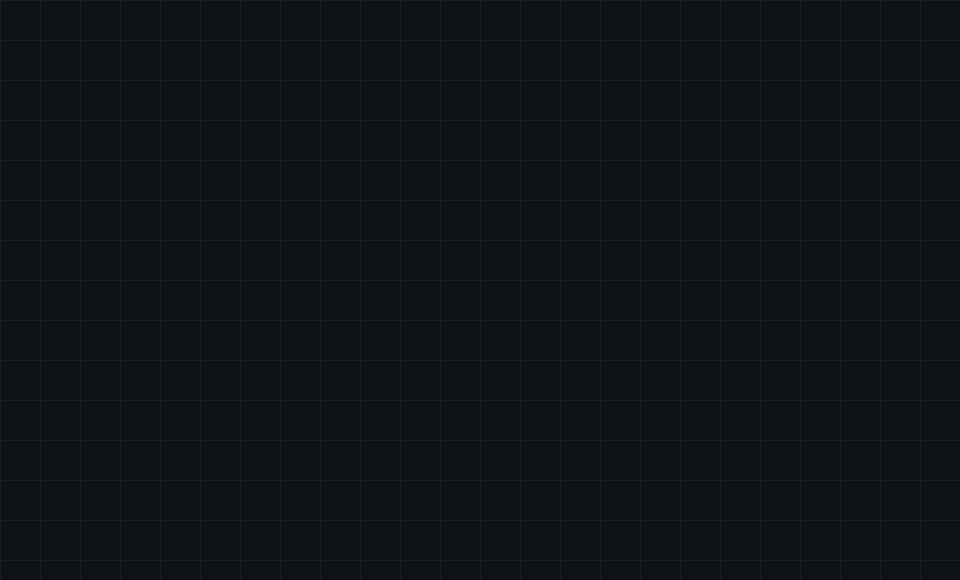

# 🏎️ DRIFT KING

> **Minimalist 2D Top-Down Arcade Drift Game**  
> Pure HTML5 Canvas, CSS3, and Vanilla JavaScript (ES6+). Zero external libraries or frameworks.



---

## 🎮 Live Demo
Deployable instantly on GitHub Pages:  
`https://vansh16soni.github.io/Drift_King/`

---

## 🎨 Visual & UI Philosophy

- **Minimalist Classic Arcade**: Clean single-screen presentation without cluttered sidebars or artificial neon glows.
- **Header**: Centered typography with subtle monospace subtitle (`retro arcade · circuit racer`).
- **Scoreboard**: Simple rounded score pills for **DRIFT**, **COMBO**, and **BEST**.
- **Centered Viewport**: Framed rectangular canvas with clean in-canvas overlays for **Ready/Start**, **Pause**, and **Session Results**.
- **Bottom Bar**: Simple pause button, track selector, car picker, and real-time status badge (`READY`, `DRIFTING`, `BANKED`, `WALL HIT`).
- **Themes**: Instant toggle between 🌙 **DARK** and ☀️ **LIGHT** mode, saved to `localStorage`.

---

## ⚙️ Drift Physics & Mechanics

1. **Top-Down Car Physics**:
   - Forward acceleration with max speed ceiling.
   - Reverse gear capped at 35% speed.
   - Rolling resistance and smooth deceleration when lifting off throttle.
   - Speed-modulated steering angle for high-speed stability.
   - Handbrake sharply reduces rear-wheel lateral traction to kick out the tail into a slide.

2. **Slip-Angle Drift Formula**:
   - Computes the angular difference between car heading and actual velocity vector ($\text{Slip Angle}$).
   - Enters **DRIFT STATE** when $\text{Slip Angle} > 15^\circ$ ($> 0.2618\text{ rad}$) and speed $> 1.7\text{ px/f}$.
   - Spawns expanding tire smoke particles and fading skidmarks behind rear wheels.

3. **Drift Combo & Score Banking**:
   - **Live Drift Points**:
     $$\text{Points} = \text{Speed} \times |\sin(\text{Slip Angle})| \times \text{Multiplier} \times 4.6$$
   - **Combo Multipliers**: Sustaining the drift increases the multiplier from `1.0×` $\rightarrow$ `1.5×` $\rightarrow$ `2.0×` $\rightarrow$ `3.0×` $\rightarrow$ `4.0×`.
   - **Bank Mechanic**: Straightening the car without crashing triggers a safe bank countdown, locking points into total score with floating notifications and chime.
   - **Wall Penalty**: Hitting outer boundaries wipes unbanked combo points, triggers screen shake, and emits collision sparks.

4. **3 Selectable Circuits**:
   - **Track 1 (Oval & Hairpin)**: Wide beginner layout for learning drift control.
   - **Track 2 (S-Chicanes)**: Technical alternating corners for flicking transitions (manji).
   - **Track 3 (Touge Circuit)**: Mountain-style circuit with tight hairpins and switchbacks.

5. **Audio Engine**:
   - **Web Audio API Procedural Synthesizer**: Real-time RPM engine throttle pitch modulation, resonant bandpass tire screeching, low-frequency wall collision thump, and harmonic bank arpeggio chime.
   - **HTML5 Audio Fallbacks**: Safe `.catch(() => {})` triggers for `move.mp3`, `screech.mp3`, `crash.mp3`, and `background.mp3`.

---

## 🕹️ Controls

### Desktop Keyboard
| Key | Action |
| --- | --- |
| <kbd>W</kbd> / <kbd>↑</kbd> | Gas / Accelerate |
| <kbd>S</kbd> / <kbd>↓</kbd> | Brake / Reverse |
| <kbd>A</kbd> / <kbd>←</kbd> | Steer Left |
| <kbd>D</kbd> / <kbd>→</kbd> | Steer Right |
| <kbd>Space</kbd> | Handbrake Drift |
| <kbd>P</kbd> / <kbd>Esc</kbd> | Pause / Resume |
| <kbd>R</kbd> | Reset Run |

### Mobile Touch Controls
- **Left Thumb**: Steer Left (<kbd>◀</kbd>) and Steer Right (<kbd>▶</kbd>).
- **Right Thumb**: <kbd>GAS ▲</kbd>, <kbd>▼</kbd> (Brake), and <kbd>DRIFT</kbd> (Handbrake).

---

## 📁 Directory Structure

```
Drift_King/
├── .nojekyll        # Disables Jekyll processing on GitHub Pages
├── index.html       # Minimal semantic HTML, canvas, score pills & overlays
├── css/
│   └── style.css    # Clean CSS variables, typography, theme toggle, simple pills
├── js/
│   └── index.js     # Cohesive JS game engine (physics, track, audio, UI)
├── img/
│   ├── car.png      # Default drift car sprite (transparent PNG)
│   ├── bmw.png      # BMW M-series sprite
│   ├── car1.png     # Pro car 1 sprite
│   ├── car2.png     # Street car 2 sprite
│   └── track.jpg    # Track background texture
├── music/
│   ├── move.mp3     # Engine sound
│   ├── screech.mp3  # Tire drift screech sound
│   ├── crash.mp3    # Wall bump sound
│   └── background.mp3 # Background audio
└── README.md
```

---

## 🚀 Deployment to GitHub Pages

1. Push this repository to GitHub:
   ```bash
   git init
   git add .
   git commit -m "first commit"
   git branch -M main
   git remote add origin https://github.com/vansh16soni/Drift_King.git
   git push -u origin main
   ```
2. In your GitHub repository, navigate to **Settings** > **Pages**.
3. Under **Branch**, select `main` and `/ (root)`, then click **Save**.
4. The `.nojekyll` file ensures all static assets (CSS, JS, images, audio) load correctly.

---

## 📄 License
MIT License. Built with pure web standards.
